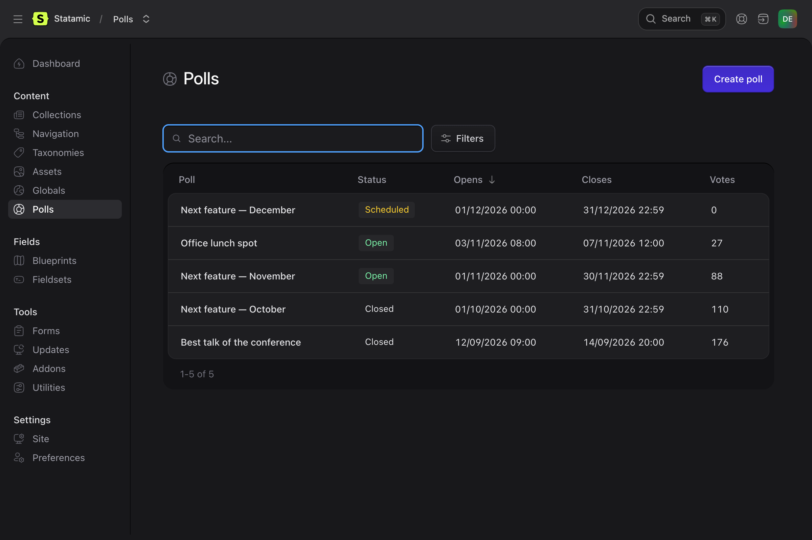
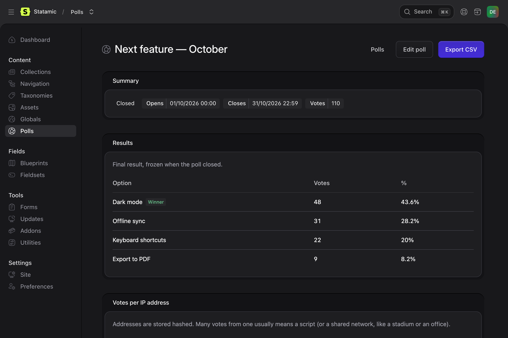

# Polls for Statamic

Simple, reusable polls and voting for Statamic 6. Answers come from any collection (hand-picked entries or a query, e.g. "every active player") or plain text. One vote per visitor, results hidden until the poll closes, and markup that is safe to cache with static caching.

## Features

- **Polls are entries** of a `polls` collection, so editors manage them in the control panel. They're translatable, and every language counts towards the same result.
- **Answers from anywhere**: hand-picked entries, every entry of a collection that matches some conditions, or free text with an image.
- **Options frozen when voting opens**, so a player leaving mid-month doesn't break the poll. While an open poll has no votes yet, editors can still change them.
- **Results revealed when voting closes** (or after voting, or always), then frozen.
- **Votes stored in files or in the database**: the `file` driver works on flat-file sites, and `database` is meant for busy ones.
- **Anonymous or logged-in voters**: an encrypted cookie, or any Laravel guard (Statamic users, your own customer accounts).
- **Abuse protection**: honeypot, bot filter, per-minute rate limit and a per-IP cap enforced atomically with the write, plus optional Cloudflare Turnstile.
- **Static-cache friendly**: nothing in the markup depends on the visitor. A small script asks for the visitor's state only when it has to, and nothing flashes for visitors who already voted.
- **Control panel page**: a searchable listing with status, group and site filters, live counts for your team, CSV export, and voiding the votes of a suspicious address.

## Installation

```bash
composer require aldanux/statamic-polls
php please polls:install --entries=players
```

`polls:install` creates the `polls` collection and its blueprint. `--entries` sets the collections editors can pick single entries from (any number), and `--container` sets the asset container for the images of text answers.

Publish the config if you want to change the defaults:

```bash
php artisan vendor:publish --tag=statamic-polls-config
```

### Storing votes in the database

```env
POLLS_DRIVER=database
```

```bash
php artisan migrate
```

The migration creates a `poll_votes` table. Votes can be moved between drivers at any time with `php please polls:migrate-votes file database`.

### Scheduler

Polls open and close on their own: `polls:sync` runs every minute through Laravel's scheduler. Make sure the scheduler is running (`* * * * * php artisan schedule:run`).

## Usage

### Templates

```antlers
{{# A poll picked with an entries field (or an id) #}}
{{ polls :poll="my_poll_field" }}

{{# Every opened poll of a group, newest first #}}
{{ polls:archive group="player-of-the-month" }}

{{# The outcome of a vote sent without JavaScript, for custom views (the default one has it).
    It depends on the visitor, so keep it in nocache, and select only what it needs. #}}
{{ nocache select="id|site" }}
    {{ polls:outcome :poll="id" }}<p>{{ message }}</p>{{ /polls:outcome }}
{{ /nocache }}

{{# The winning answer of the latest closed poll, e.g. for a banner #}}
{{ polls:winner group="player-of-the-month" }}
    {{ winner:label }} — {{ winner:percent }}%
{{ /polls:winner }}
```

As tag pairs, `polls` and `polls:archive` expose their data (`question`, `options`, `results`, `status`, `is_open`, `closes_on_text`, and more) so you can write your own markup.

### Front-end script

Include the script on pages that show polls. It fetches the visitor's state and sends votes without reloading the page. It sets itself up on import:

```js
// resources/js/site.js
import '../../vendor/aldanux/statamic-polls/resources/js/polls.js'
```

Or publish it and load it directly:

```bash
php artisan vendor:publish --tag=statamic-polls
```

```html
<script type="module" src="/vendor/statamic-polls/js/polls.js"></script>
```

Without JavaScript, the form still posts on uncached pages and with the `half` strategy: the visitor comes back to the page and sees the outcome ("Thanks for voting!") above the poll. With the `full` strategy, voting needs JavaScript (see below), so the default view leaves that message out: it would cost a PHP request on every page view.

Add the pre-paint helper to your layout's `<head>`. It hides the voting form before the first paint for visitors who already voted:

```antlers
{{ polls:head }}
```

### Static caching

Polls have no URL of their own, so Statamic can't know which pages show them. If you use static caching, list those pages in the invalidation rules. `polls:sync` saves a poll when it opens and when it closes, and these rules turn that save into fresh pages:

```php
// config/statamic/static_caching.php
'invalidation' => [
    'rules' => [
        'collections' => [
            'polls' => ['urls' => ['/player-of-the-month']],
        ],
    ],
],
```

With the `full` strategy, voting needs JavaScript: Statamic swaps the cached CSRF token by script.

### Cloudflare Turnstile (optional)

The built-in checks (honeypot, bot filter, rate limit, per-IP cap) need no setup. For stronger protection against scripted votes, add [Cloudflare Turnstile](https://developers.cloudflare.com/turnstile/):

1. In the Cloudflare dashboard, go to **Turnstile → Add widget**, add your domain and copy the site key and the secret key.
2. Add both to `.env`. Turnstile is on only when both are set:

```env
POLLS_TURNSTILE_SITE_KEY=0x4AAAAAAA...
POLLS_TURNSTILE_SECRET=0x4AAAAAAA...
```

That's all: you don't add Cloudflare's script yourself. `polls.js` loads it once (`https://challenges.cloudflare.com/turnstile/v0/api.js?render=explicit`) and renders the widget in every open poll. Each vote must carry the widget's token. If a vote is turned away, the widget is reset, so the visitor gets a fresh token and can try again.

Before you turn it on:

- **Votes are verified with Cloudflare.** The widget loads from Cloudflare's servers for every visitor who sees an open poll, not only those who vote, and runs its check in their browser. When a vote is sent, your server passes its token and the visitor's IP address to Cloudflare's [siteverify API](https://developers.cloudflare.com/turnstile/get-started/server-side-validation/). Mention Cloudflare as a processor in your privacy policy; see Cloudflare's [Turnstile privacy addendum](https://www.cloudflare.com/turnstile-privacy-policy/).
- **Voting needs JavaScript**, since the widget only runs in the browser. A vote sent without it is turned away with "We could not verify you are not a robot".
- **Content Security Policy**: allow `https://challenges.cloudflare.com` in `script-src` and `frame-src` ([details](https://developers.cloudflare.com/turnstile/reference/content-security-policy/)). If the script can't load (blocked by the policy or an ad blocker), the visitor is told the check failed and it is tried again on the next click.
- **Custom views** must keep the placeholder inside the form, and the messages on the error element:

```antlers
{{ if turnstile_site_key }}
    <div data-poll-turnstile data-sitekey="{{ turnstile_site_key }}"></div>
{{ /if }}

<p data-poll-error
   data-poll-error-verifying="{{ trans key='statamic-polls::messages.verification_pending' }}"
   data-poll-error-unverified="{{ trans key='statamic-polls::messages.verification_failed' }}"
   hidden></p>
```

To try it locally, use Cloudflare's [testing keys](https://developers.cloudflare.com/turnstile/troubleshooting/testing/): site key `1x00000000000000000000AA` with secret `1x0000000000000000000000000000000AA` always passes, and secret `2x0000000000000000000000000000000AA` always fails.

### Customising the markup

```bash
php artisan vendor:publish --tag=statamic-polls-views
```

The views end up in `resources/views/vendor/statamic-polls`. Keep the `data-poll*` attributes, because the script relies on them.

## Control panel

**Content → Polls** lists every poll with its status and vote count, and you can filter by status, group and site. A poll's page shows the live count (visitors never see it before closing), exports the results as CSV, and lists the addresses that voted most, so you can void a scripted burst.





There are two permissions: **View poll results** and **Void poll votes**.

## Privacy

Without Turnstile, nothing leaves your server. Anonymous voters get an encrypted `poll_voter` cookie, set only when they vote, so they can't vote twice. Votes store a keyed hash of the IP address (for the per-address cap), never the address itself. With Turnstile on, see above for what is sent to Cloudflare.

## Monthly polls

```bash
php please polls:duplicate {poll-id} --next-month
```

Copies a poll, with its translations, to next month: the new poll opens on the 1st and closes at the end of the month, and the month in each title is updated in its own language. The copy is unpublished and has no votes.

## Configuration

| Key | Default | |
|---|---|---|
| `collection` | `polls` | Collection holding the polls |
| `driver` | `file` | `file` or `database` (`POLLS_DRIVER`) |
| `voters.public` / `voters.authenticated` | built-in | Implement `Aldanux\StatamicPolls\Voters\Voter` for your own |
| `guard` | default guard | Guard used by logged-in polls (`POLLS_GUARD`) |
| `protection.max_votes_per_ip` | `25` | Votes one address may cast per poll (0 = no cap) |
| `protection.rate_limit_per_minute` | `10` | Vote attempts per address per minute |
| `turnstile.site_key` / `turnstile.secret` | — | Enable [Cloudflare Turnstile](#cloudflare-turnstile-optional) (`POLLS_TURNSTILE_*`) |

## Testing

```bash
composer install
composer test
```

## License

MIT. See [LICENSE](LICENSE).
